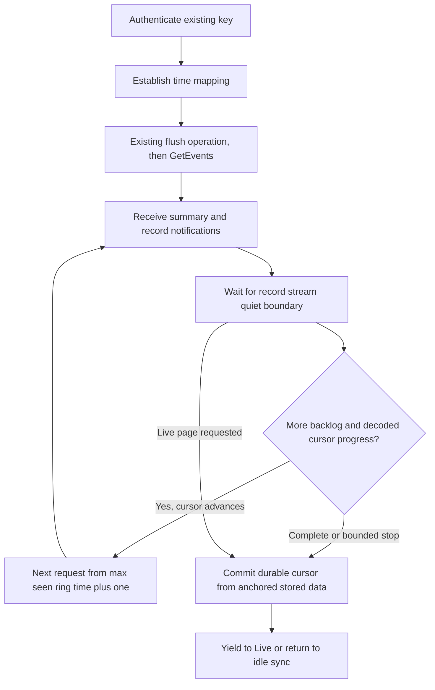

# Historical data extraction

[Index](Home.md). This describes the present NOOP Android implementation and its existing
cross-platform protocol contract. It does not assert that the official app uses every same
timeout or storage decision.

## What is downloaded

The ring collects records while the phone is absent. Opening NOOP starts the existing
authenticated sync path when the source reaches its ready state. History includes different
record families for nighttime intervals, daytime intervals/quality, temperature, motion,
sleep phases, HRV and available optical/oxygen information. Not every feature emits every
day. A nightly estimate is not a continuous live channel.

Three stores must stay distinct: records still on the ring, records already saved in NOOP's
on-device database, and official-app/cloud analysis. NOOP has no Oura-cloud dependency.
A successful local drain does not establish official-cloud completeness, and cloud insight
cannot be assumed to be a raw sensor record.

## Request, batches and clocks

The current pure builder produces:

```text
10 09 <ring_timestamp:4 little-endian> <maximum_events:1> ff ff ff ff
```

Cursor 0 requests from the beginning of available history. NOOP requests up to 255 events
per batch. The response summary `0x11` contains an event count, analysis progress and
`bytes_left`; **it contains no resume timestamp**. A decreasing remaining-byte count is
transfer progress, not a clock or a database key.

Each event envelope carries its own unsigned ring timestamp. NOOP resolves it through a
validated ring-to-UTC anchor (`0x42`, or supported current synchronization evidence).
Unanchored records cannot silently acquire phone receipt time as historical measurement time.
The default ring tick model is 100 ms, but epoch/session continuity still needs validation.



This diagram summarizes current behavior; it is not vendor pseudocode. For records with equal
timestamps and boundary behavior, retain the current fixture-tested cursor convention rather
than substituting a different inclusive/exclusive assumption from a protocol name.

## Why the waits matter

Earlier captures show the summary can arrive before the batch finishes. Issuing another
GetEvents immediately can restart serving the same window. NOOP waits for 1.5 seconds of
record silence before continuation, then requests from the highest seen envelope time plus
one. No records or a non-advancing cursor ends the pass instead of replaying it indefinitely.

The **in-session cursor** and **durable cursor** serve different purposes. The intended seen
high-water mark is broader than saved data, but the current Android receive path updates it
and resets the quiet timer only when decoding produces nonempty events. Unknown tags return
no decoded events, so their envelope times do not currently advance this cursor. An
unknown-only tail is therefore an implementation limit; it is not evidence that every valid
envelope has been incorporated. The durable cursor follows only anchored, stored data under
the current time mapping. Persisting a received-but-unsaved high-water mark can skip data after
an interruption. Persisting `bytes_left` as a timestamp previously caused repeated full dumps.

At a completed page boundary, foreground Live takes priority. History resumes only after
the serialized live cleanup barrier completes. There is no invented ring-side pause command.
Opening multiple graphs cannot start concurrent independent history drains.

## Retention, flush and multiple apps

The existing path sends `28 01 00` before fetching history. Earlier notes disagree about
whether its primary effect is finalizing buffered records/analysis or affecting what remains
available to another client. No current capture proves its complete retention semantics.
This wiki does not equate the word “flush” with erase or with a harmless read.

An earlier report found missing windows after alternating clients. That is a reported
interoperability problem, not proof that every read consumes history or that the ring can
only ever have one OS bond. Client seek state, acknowledgments, retention, actual deletion,
and independently configured sensors can produce similar symptoms. Keep the official app
stopped while attributing NOOP transfer behavior. Do not test by deleting keys or history.

No read-only guarantee is established for arbitrary acknowledgment or erase-looking
operations. NOOP does not add a max=0 acknowledgment experiment or alter flush semantics
as part of documenting speed. A future retention study needs an explicit preservation
contract and independent evidence before a connect-path change.

## Missing history and extraction limits

| Symptom | Evidence to inspect | What it does not prove |
| --- | --- | --- |
| No recent HR | Feature mode, last stored age, actual sample count, completed sync | Broken key, when session authentication succeeded |
| Repeated same backlog | Seen/stored cursor separation, time mapping, notification tail, summary progress | Need to reset the ring |
| Old samples after switching apps | Current seek state and anchor continuity | A ring reboot by itself |
| Unknown timestamp | Anchor validity, parked record counts and generation | That arrival time is measurement time |
| No overnight oxygen estimate | Actual emitted tags, available optical records and sensing state | A continuous live O₂ stream is available but hidden |
| Drain stops with backlog | Summary-evaluated deadline/stall reason and stored progress | Transfer complete |
| Drain stays silent without a summary | Connection state and last response, separately from local write completion | A five-minute watchdog will necessarily terminate it; current deadline evaluation requires a summary |
| Official app has additional insight | Provenance and whether result requires remote analysis | Missing BLE command or a local decoder bug |

Oura currently documents **up to three days** of ring-local data for Ring 5 and **up to seven
days** for Ring 4/Gen3, and recommends daily synchronization.
[Official memory-capacity guidance](https://support.ouraring.com/hc/en-us/articles/360025428394-Product-Safety-Use).
These are public product limits, not measured byte budgets or guaranteed retention under raw
research workloads. The vendor also reports overwrite when memory fills and possible loss
of unsynced data after power-off.
[Official missing-data guidance](https://support.ouraring.com/hc/en-us/articles/39695406607507-Troubleshooting-Gaps-in-Sleep-Data).
Neither fact settles whether reads consume records. Exported app history can outlive ring retention. Preserve local backups before
app replacement; an imported authentication key does not import historical databases.

The installed official package also contains a separate extended history route with a wider
cursor and fragmented envelopes. Its format, watchdog and buffer candidates are documented
[separately](Official-app-protocol-candidates.md); NOOP currently uses the legacy path above.

The current guard values are listed in [timings and limits](Timings-and-limits.md).
The byte reference and prior observations are in [protocol section 5](../OURA_PROTOCOL.md).
